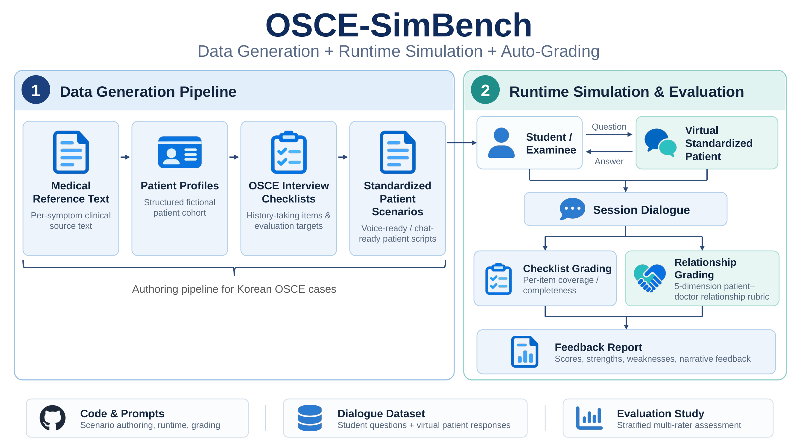
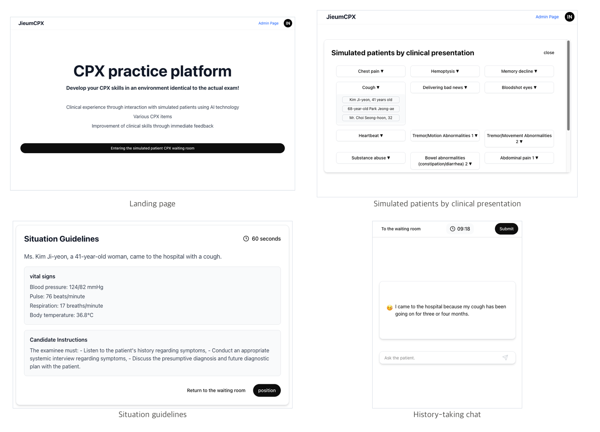
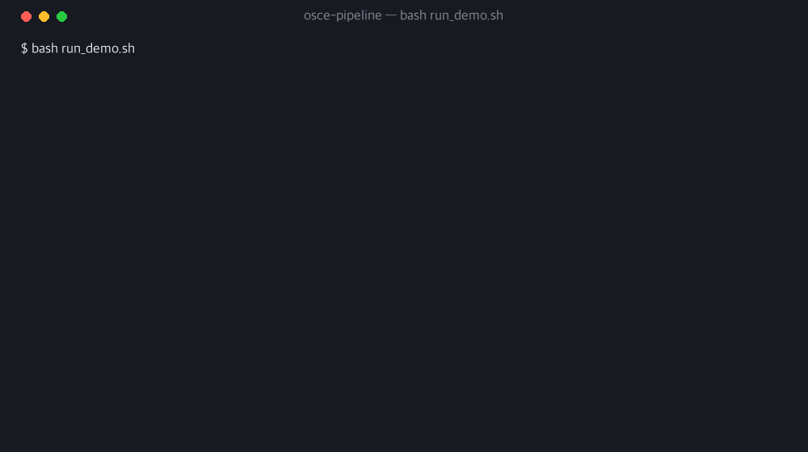
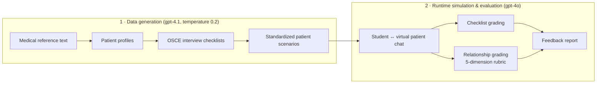
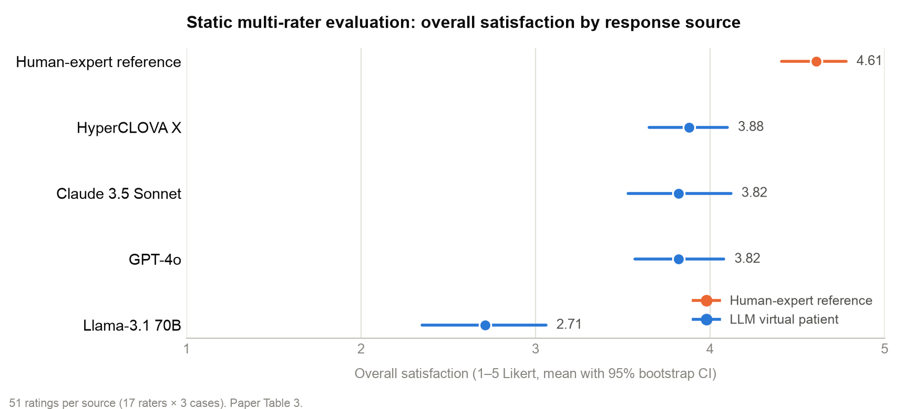
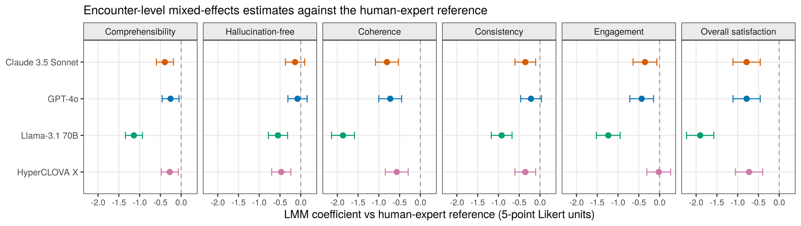
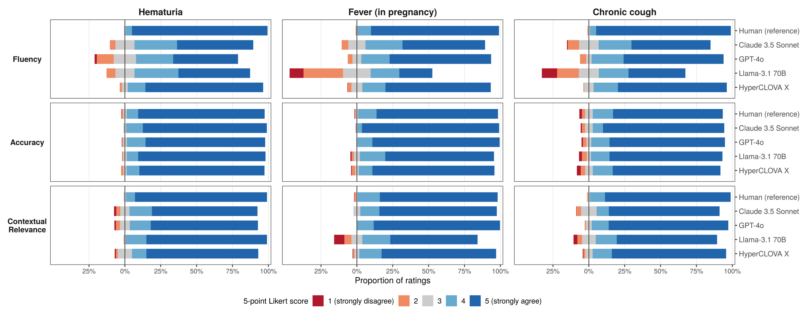
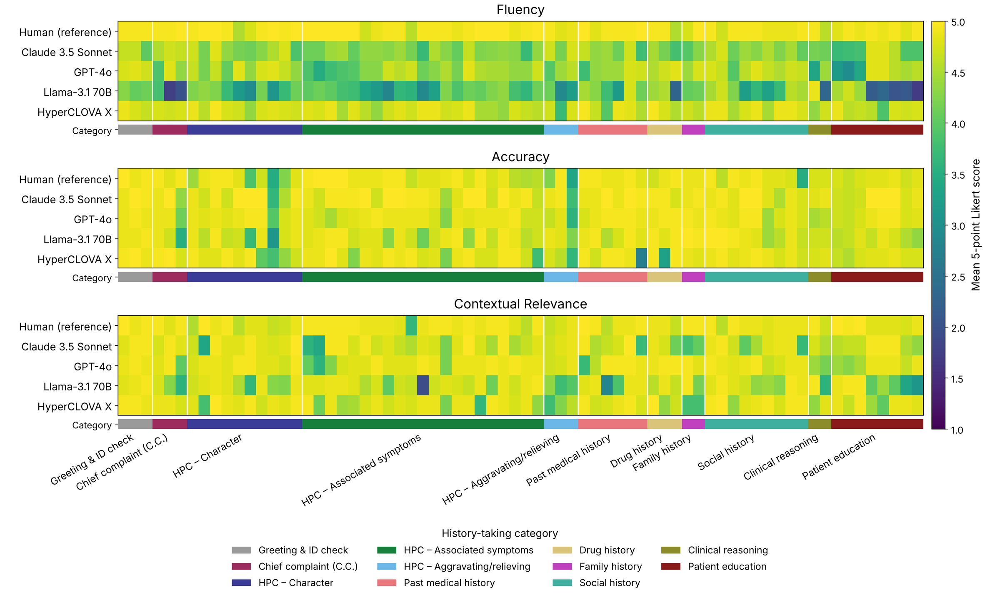

<h1 align="center">OSCE Simulated-Patient Pipeline</h1>

<p align="center">
LLM-based virtual standardized patients for Korean OSCE history-taking:<br>
scenario authoring, dialogue simulation, and auto-grading
</p>

<p align="center">
<a href="#citation"></a>
<a href="https://huggingface.co/datasets/nwirandx/Korean-OSCE-history-taking-dialogues"></a>
<a href="LICENSE"></a>

</p>

<p align="center">
<b>A Stratified Multi-Rater Evaluation of LLM-Based Virtual Standardized Patients with a Deployed Data-Generation Platform</b><br>
Yongjin Yi · Jinyong Park · Sejoong Kim<br>
Dankook University · Seoul National University
</p>

<p align="center">
<a href="https://huggingface.co/datasets/nwirandx/Korean-OSCE-history-taking-dialogues">Dataset</a> ·
<a href="#terminal-demo">Demo</a> ·
<a href="#pipeline">Pipeline</a> ·
<a href="#evaluation-results">Results</a> ·
<a href="#quick-start">Quick start</a> ·
<a href="prompts/README.md">Prompts</a> ·
<a href="docs/dataset_card.md">Dataset card</a> ·
<a href="#citation">Citation</a>
</p>



## At a glance

<table align="center">
  <tr>
    <th colspan="2" align="center">Static human evaluation</th>
    <th colspan="2" align="center">Released platform dataset</th>
  </tr>
  <tr>
    <td align="center"><h3>17</h3>medical-student raters</td>
    <td align="center"><h3>7,480</h3>rating actions</td>
    <td align="center"><h3>49</h3>dialogue sessions</td>
    <td align="center"><h3>1,763</h3>question–answer pairs</td>
  </tr>
  <tr>
    <td colspan="2" align="center">4 LLMs + human-expert reference · 3 OSCE cases · 70 prompts</td>
    <td colspan="2" align="center">17 participants · 27 clinical scenarios · GPT-4o virtual patient</td>
  </tr>
</table>

The two resources are distinct. The static evaluation compares response
sources on fixed prompts; the platform dataset contains full history-taking
dialogues collected on the deployed training platform.

## Overview

This repository provides a framework for authoring and evaluating Korean
OSCE (Objective Structured Clinical Examination) cases with large language
models. It includes two complementary components:

1. **Data generation** — turns per-symptom medical reference text into a
   structured corpus of fictional patients, OSCE-style interview checklists,
   and voice-ready standardised-patient scenarios.
2. **Runtime + auto-grading** — drives a simulated-patient chat from any of
   those scenarios, then auto-grades the student's session against the
   checklist and a five-dimension patient–doctor-relationship rubric.

| Resource | Scope | Access |
|---|---|---|
| Static multi-rater evaluation | Four LLMs and a human-expert reference; 3 OSCE cases; 70 input prompts; 17 raters; 7,480 rating actions | Described in the paper and its appendices |
| Platform dialogue dataset | 49 sessions; 17 participants; 27 clinical scenarios; 1,763 question–answer pairs | [Hugging Face](https://huggingface.co/datasets/nwirandx/Korean-OSCE-history-taking-dialogues), CC-BY-NC-SA-4.0 |
| Code and prompts | Scenario authoring, a terminal-based patient simulation, grading, and Korean/English prompt templates | This repository, MIT |

The hosted dialogue dataset contains student questions and GPT-4o patient
responses. The closed reference corpus and full generated patient cohort
are documented in [`data/README.md`](data/README.md). The code here provides
the generation pipeline and terminal demo; see
[`docs/runtime.md`](docs/runtime.md) for the runtime interface.

## Deployed platform

The released dialogues were collected on a web-based training platform
built on this pipeline. Students pick a simulated patient by clinical
presentation, read the station guidelines and vital signs, and take a
history in a timed text chat; the platform grades each session with the
same checklist and relationship rubric used by the terminal runtime.



The web application itself is not part of this repository. Its output is
released as the
[dialogue dataset](https://huggingface.co/datasets/nwirandx/Korean-OSCE-history-taking-dialogues);
the prompts and grading logic it runs are the ones published here.

## Terminal demo



The animation replays the first six of 28 turns of session 578 from the
released dataset in the format printed by `run_demo.sh`. The grey lines are
the dataset's English translations, and the final score is the platform
score recorded for that session. The live demo streams the patient's answers
turn by turn and prints the checklist score, relationship mean, grade, and a
written feedback report when you type `exit`:

```bash
bash run_demo.sh              # Korean, bundled sample patient
bash run_demo.sh --lang en    # English prompts
```

The demo calls the OpenAI API with the key in your `.env`; see
[Quick start](#quick-start) and [`docs/runtime.md`](docs/runtime.md).

## Pipeline



Stage by stage: [`docs/pipeline.md`](docs/pipeline.md) covers the four
generation stages, [`docs/runtime.md`](docs/runtime.md) covers simulation,
grading, and the score formula, and [`prompts/README.md`](prompts/README.md)
indexes all nine prompt templates in Korean and English.

## Evaluation results

The study evaluates three sentence-level and six encounter-level metrics.
An 11-category history-taking taxonomy and three linguistic-form labels
help identify question-specific failure patterns. The human-expert
reference has the highest mean on all six encounter-level metrics.



Overall satisfaction on a 1–5 Likert scale (paper Table 3; 95% bootstrap
confidence intervals; 51 ratings per source across three cases). These
results describe the static evaluation, not the automated scores in the
platform dataset.

### Figures from the paper

**Figure 1 · Encounter-level differences from the human reference.**
Linear mixed-effects estimates of the mean difference from the human-expert
reference, in 5-point Likert units, with 95% confidence intervals for each
LLM and encounter-level metric. The human reference sits at 0 by
construction; negative values fall below it.



**Figure 2 · Sentence-level rating distributions.** Diverging stacked bars
of Likert ratings for the three sentence-level metrics, for each of the five
sources and each of the three OSCE cases. The vertical zero line separates
negative ratings (1–2 plus half of 3) from positive ratings (4–5 plus half
of 3).



**Figure 3 · Per-question heatmap.** Mean Likert score per question and
source for Fluency, Accuracy, and Contextual Relevance. Within each panel,
rows are the five sources and columns are the 70 input prompts sorted by
history-taking category; the colour bar under each panel maps prompts to
their category.



## Quick start

```bash
git clone https://github.com/JINAILAB/osce-pipeline.git
cd osce-pipeline
python -m venv .venv
source .venv/bin/activate
pip install -r requirements.txt
cp .env.example .env       # then put your OpenAI key in .env
bash run_demo.sh           # interactive demo with the bundled sample patient
```

Type `exit` to finish the encounter and generate the grading report.

## Use the dialogue dataset

The dataset can be loaded independently of the generation pipeline:

```python
from datasets import load_dataset

dialogues = load_dataset("nwirandx/Korean-OSCE-history-taking-dialogues", split="sessions")
session = dialogues.filter(lambda row: row["session_id"] == 564).sort("turn")
for turn in session:
    print("Student:", turn["question"])
    print("Patient:", turn["answer"])
```

This example uses the `datasets` package. The dataset card describes all
columns, English translations, and anonymisation. See
[`docs/dataset_card.md`](docs/dataset_card.md) for the relationship between
the released dialogues and the generated patient cohort.

## Bulk data generation

Place one UTF-8 text file per chief complaint under `data/seed/`, then run:

```bash
bash run_all.sh
```

A synthetic placeholder reference file is shipped at
[`data/samples/input/cough.txt`](data/samples/input/cough.txt) — copy it
into `data/seed/` for a single-symptom dry run.

### Running stages individually

```bash
python -m src.pipeline.stage1_process_disease_list
python -m src.pipeline.stage2_merge_json
python -m src.pipeline.stage3_generate_checklist [--test]
python -m src.pipeline.stage4_generate_scenario \
    [--symptom-limit N] [--disease-limit N] [--batch-size N]
```

## Models and decoding

| Component | Model | Temperature | Seed |
|---|---|---|---|
| Data-gen stages 1, 3, 4 | gpt-4.1 | 0.2 | 42 |
| Runtime: checklist / scenario / grading | gpt-4o | 0 | 42 |
| Runtime: patient role-play | gpt-4o | 0.5 | 42 |

These are the defaults in the public code. The released platform dataset
records the dated model `gpt-4o-2024-11-20`, while the terminal demo uses
the `gpt-4o` alias. Consult the
[dataset card](https://huggingface.co/datasets/nwirandx/Korean-OSCE-history-taking-dialogues)
for the collection configuration. Seeded calls provide best-effort
reproducibility; the alias does not pin the historical model snapshot.

## Repository layout

```
.
├── assets/                         README figures (overview, demo GIF, results, paper figures)
├── src/
│   ├── prompts/                    Bilingual prompt module (ko.py, en.py)
│   ├── pipeline/                   Data-generation stages 1–4
│   ├── runtime/                    Simulator + interactive demo
│   ├── grading.py                  Auto-grader (per-item + relationship)
│   ├── utils.py, logging_utils.py
│   └── json_to_excel.py            Optional checklist export to .xlsx
├── prompts/                        Markdown documentation, one per prompt
│   ├── README.md                   Index of all 9 templates
│   ├── 01_generate_disease_list.md
│   ├── 02_generate_checklist.md
│   ├── 03_generate_scenario_draft.md
│   ├── 04_generate_scenario_polish.md
│   ├── 05_runtime_checklist.md     Runtime-side variant of the checklist prompt
│   ├── 06_chatbot_system.md
│   ├── 07_grading_checklist.md
│   ├── 08_grading_relationship.md
│   ├── 09_grading_feedback.md
│   └── en/                         Mirror of the above, in English
├── data/
│   ├── samples/                    Tiny example I/O committed to the repo
│   └── seed/                       gitignored — corpus + run outputs
├── docs/
│   ├── pipeline.md                 Data-generation flow
│   ├── runtime.md                  Runtime + grading flow
│   ├── dataset_card.md
│   └── ethics.md
├── croissant.json                  Croissant 1.0 + RAI metadata
├── run_all.sh                      bulk dataset generation
├── run_demo.sh                     interactive single-patient demo
├── requirements.txt
├── .env.example
└── LICENSE
```

## Citation

```bibtex
@inproceedings{yi2026vsp,
  title     = {A Stratified Multi-Rater Evaluation of LLM-Based Virtual
               Standardized Patients with a Deployed Data-Generation Platform},
  author    = {Yi, Yongjin and Park, Jinyong and Kim, Sejoong},
  booktitle = {Advances in Neural Information Processing Systems
               (NeurIPS 2026), Track on Evaluations and Datasets},
  year      = {2026}
}
```

## License

Code is released under the [MIT License](LICENSE). The seed corpus and
generated dataset are licensed separately — see
[`data/README.md`](data/README.md) and
[`docs/dataset_card.md`](docs/dataset_card.md). Ethics, suitable /
unsuitable uses, and risk mitigations are documented in
[`docs/ethics.md`](docs/ethics.md). Machine-readable Croissant 1.0 +
RAI metadata for the synthetic patient cohort is in
[`croissant.json`](croissant.json). Outputs of the upstream OpenAI
models (`gpt-4.1`, `gpt-4o`) are additionally governed by OpenAI's
[Usage Policies](https://openai.com/policies/usage-policies) and
[Sharing & Publication Policy](https://openai.com/policies/sharing-publication-policy).
